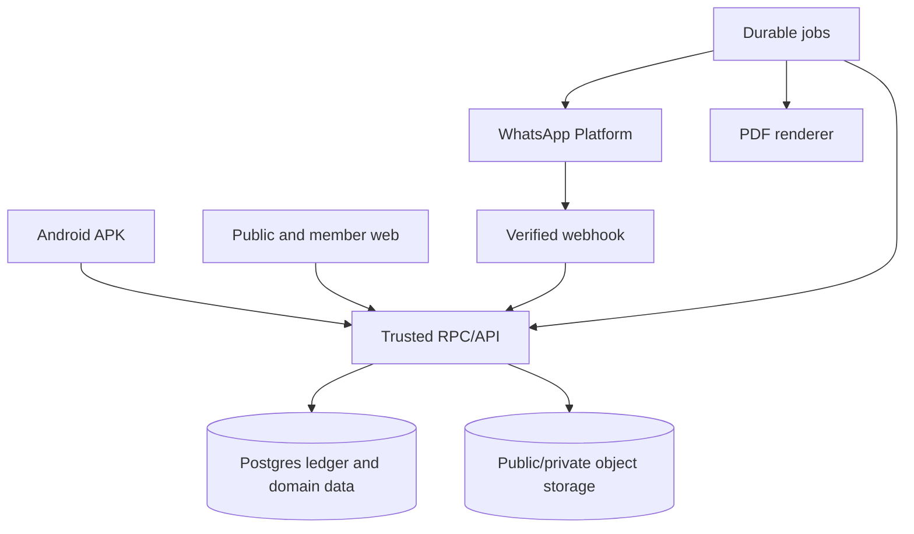

# Architecture and Workflow Baseline — 15 October 2026

**Status:** Task 3 target architecture complete; implementation and contradictory product decisions remain Tasks 4–10. This document describes intended boundaries and state transitions, not existing deployed behavior. The latest user requirements in `REQUIREMENTS_BASELINE_2026-10-15.md` take precedence over older drafts. Unresolved decisions remain visible at the end.

## 1. Target architecture

The existing repository uses Supabase (Auth, PostgreSQL, RLS, Storage, Edge Functions), Next.js web and Expo/React Native Android. Preserve those foundations unless a documented feasibility review identifies a blocker. Authenticated clients use trusted Postgres RPCs and protected server routes/Edge Functions; public routes expose only narrowly projected data. Enforce permissions in server/database policy, never only navigation/UI. Use private buckets for bills, payroll-related files, meeting memos and receipts; public event images should be separate and intentionally public. Supabase service keys, Meta tokens, Drive credentials and signing material remain server/operations secrets, never client assets.

The user has allocated 4 TB in Google Drive for project use. Use it as an independently administered secondary archive destination (encrypted backups and selected report/media archives) after OAuth ownership, least-privilege scopes, upload retries, and restore procedures are approved. Do not treat Drive as the live relational database or assume a folder is private merely because its link is hard to guess. The application remains functional if Drive backup upload is delayed; alert operators and retain the provider backup/export path.

## 2. Data domains to model

- Identity, member, role assignment, account status, WhatsApp contact, consent/opt-out history.
- Monthly donor profile, referrer, effective monthly amount, per-month contribution due/status/payment record, reminders, verified receipt, referral points.
- Accounts, opening balances, donations, collection tasks/count submissions, expenses/approvals/payments, transfers, advances/settlements, salary payments, receipts, report runs.
- Tasks, volunteer/assigned participants, waitlist positions, completion submissions and verification.
- Meetings, invite responses, meeting memo files, geofence check-ins, organizer correction records, Hafiz prayer attendance.
- Announcement versions/schedules, public event images, app release policy, system settings/QR current asset.
- Notification outbox, WhatsApp webhook inbox, delivery attempts, idempotency keys, audit events, backup/restore runs.

Use exact decimal/integer minor units for INR, immutable identifiers, server-generated timestamps plus explicit business dates, and unique constraints for one donor/month payment allocation where business rules require them.

## 3. Main event flows

### Monthly contribution

1. Authorized user adds donor and records consent, WhatsApp number, amount, and referrer.
2. First Friday 10:00 Asia/Kolkata scheduled job selects active opted-in donors and their currently effective amount. At dispatch it uses the current QR and records a message ID, template revision and QR asset digest; old QR image assets are not retained in the user-facing configuration. The request can tell someone who already paid to ignore it. Retry is bounded and observable.
3. Donor replies with transaction ID or STOP. Incoming message is matched to donor and current period; it creates a pending submission only. STOP updates suppression immediately.
4. Treasurer compares bank/UPI receipt to transaction ID and amount; verifies or rejects with reason.
5. Verification atomically posts the finance effect, allocates to the correct period, creates receipt and referral point, then queues receipt-number + website-link WhatsApp message.
6. Website receipt lookup produces the PDF without exposing other records. A five-day reminder is eligible only for a month with no verified contribution; after three consecutive such months, notify the referrer. Any verified amount counts for the month and has a receipt for that amount. Suggested-amount changes appear in the current month's profile while preserving sent request and receipt snapshots; pending claims cannot be silently classified as contributed.

### Task completion

Creator creates task and participation mode/capacity. Invitees accept or decline, open volunteers join, overflow joins FIFO waitlist. Assigned member submits completion (optional note). Creator verifies/closes; only then is completion performance credited. If the creator is unavailable, retain pending state.

### Expense and advance

Expense requester records details and bill. Approval rules: normal requester → President; President requester → Treasurer; Treasurer requester → President. After approval, Treasurer records payment evidence and account movement. Amount edits return to approval. Advance requires President or VP approval, is paid by Treasurer, then bills/unused return reconcile it.

### Cash collection

Collection task has one or more assigned counters. Counter submits total; task remains pending until Treasurer verifies. Treasurer direct entry can post immediately under the user’s chosen rule. Verified amount creates one linked Cash-income ledger item; prevent duplicate posting by idempotency key. Cash-to-bank deposit is a separate internal transfer.

### Meeting attendance

Invited member accepts/declines. Reminder job sends one hour before, excluding declined. At meeting, member checks in within configurable 100 m radius. Organizer may manually record present only while physically at masjid; persist actor, timestamp, and evidence mode. After organizer finalizes roster, send absence notices and update meeting participation score.

### Finance report

Select monthly, calendar-year, or date range. Build from authoritative ledger effects, not cached dashboard totals. Include itemized transactions and summary totals. Optional supporting-proof references are selected by Treasurer. Generate a versioned PDF and retain report status (queued/ready/failed) and period/source cutoff.

## 4. Reliability and security requirements

- Every scheduled send and webhook must be idempotent. Store incoming webhook event IDs and status transitions before side effects.
- Queues need retry limits, backoff, dead-letter/error visibility, and a manual resend mechanism.
- Offline records carry client-generated idempotency IDs and remain explicitly pending until server acceptance. Do not allow stale offline state to silently overwrite newer financial data.
- RLS/API authorization tests cover each role and both platforms; denial is tested at data/API layer, not only UI.
- QR changes, role changes, expense approval/payment, donor consent/opt-out, report generation, attendance correction, backup restore, and transaction correction/deletion require audit events.
- Never store Meta access tokens, service-role keys, or signing secrets in mobile/web client bundles or repository.
- Drive backup integration credentials must be held server-side; use the narrowest feasible Drive scope and restrict access to the chosen project folder.
- Public files must be intentionally public; private receipts/bills use access checks and short-lived download paths where appropriate.
- Keep backups of database and object files, and test restoration before launch. A successful backup job is not proof that restore works.

## 5. Components, ownership and trust boundaries

| Component | Owns | Trust boundary / behavior |
|---|---|---|
| Android APK | Role-specific UI, local pending drafts, device permission prompts, push token | No authority over money, attendance, approvals or roles; server decides on sync. Cache only necessary data, keep session in secure storage. |
| Next.js public web | Masjid information, public announcements/media, APK link, limited receipt lookup | Anonymous visitors cannot query general member, donor, payroll or finance tables; lookup endpoint rate-limits and returns a fixed projection. |
| Next.js authenticated web | Board and member workflows, masjid laptop operator view, report/receipt downloads | Validate session and object permission on every action/download; proxy or issue scoped short-lived private-file access. |
| Supabase Auth + PostgreSQL | User identity, role bindings, domain state, financial ledger, audit, constraints and idempotency | Trusted mutations occur in transactions through narrow RPCs or privileged server routes; RLS covers exposed tables. Current role keys need Task 4 migration planning. |
| Storage and renderers | Bills, memos, QR, event media, generated PDFs | Separate public/private buckets, validate MIME/content/size, use opaque paths, short-lived private links and lifecycle cleanup. Metadata and file bytes must both be backed up. |
| Durable scheduler and outbox | Due requests, reminders, WhatsApp/push sends, retries, reports and backup jobs | Jobs claim work atomically, may run more than once, and must be idempotent. Network calls occur after committed state; failure stays visible. |
| Meta webhook ingress | Verify incoming authenticity, dedupe message/status events and route replies | Treat donor text/transaction ID as untrusted claim; STOP suppresses future sends immediately; only Treasurer verification posts money. |
| Backup operator | Encrypted database/object archive, manifest, retention and restoration | Drive is a secondary archive, not the live database. Laptop account requests restore through a protected server-side operator path; it never receives cloud admin credentials. |

Realtime is a presentation channel for fresh authorized state, not a financial command channel. After a reconnect, clients refetch authoritative rows. The browser uses HTTPS for location prompts. A sideloaded APK relies on the same signing key and incremented Android version code for upgrade.

## 6. Logical data model and invariants

These are conceptual aggregates; table/column names and migrations are Task 6 work. Every operation carries actor, server time and an idempotency key where replay is possible.

| Aggregate | Core records and links | Invariants |
|---|---|---|
| Identity | `application_user`, role grant, member profile, status, account session/audit | Deactivation never erases past actor attribution. System Admin and masjid laptop are distinct authority profiles. Multiple holders may share a role, never credentials by design. |
| Donor | One-time contribution, monthly donor, consent history, monthly period/amount version, payment claim, verification, receipt, referrer | A promise/request does not increase cash. A payment claim stays pending until verified. Unique period/send/claim operation keys prevent double credit. |
| Finance | Account, opening-balance verification, ledger effect, expense/request/approval/payment, transfer, advance/settlement, salary, cash count, reconciliation, audit | INR is integer paise; transfer balances sum to zero across asset accounts; payment is not posted at expense approval; verified cash posts once; every visible correction/deletion retains a before/after audit trail and compensating effects pending Task 5 decision. |
| Work | Task, assigned/volunteer slots, waitlist, completion submission, creator decision | Atomic caps across mixed modes; at most one active slot per user/task; points after verification only; FIFO waitlist transitions never overfill. |
| Meetings | Meeting, invite/RSVP, memo reference, attendance event, final roster, absence event | Member GPS check-in only on scheduled India-local date and inside policy; manual organizer action requires onsite location evidence; a declined invitation is distinct from absence. |
| Hafiz attendance | Prayer calendar/date, five prayer slots, mark/correction event | One current mark per local date/prayer; correction keeps actor/time/old/new even without a reason. Separate from member Jummah attendance. |
| Messaging/content | Announcement version, audience, publish/expiry, QR current asset/digest, outbox/inbox/delivery, push token | Opt-out checked again at send time; publish only to intended audience; old QR image is not retained in active configuration, while send metadata preserves digest. |
| Reports/operations | Report run/snapshot/cutoff/file hash, release policy, backup manifest, restore job/audit | Every generated total ties back to included ledger events. Release gate never removes web access or blocks update download. Restore result is verified against file and DB manifest. |

Financial corrections need one coherent definition before migrations: the user selected direct Treasurer edit/delete, while current schema enforces immutable posted history. Proposed UI behavior is edit/remove from the active view, implemented through versioned supersession/tombstone plus balancing ledger corrections so prior receipts/reports remain explainable. The exact approval and disclosure policy is Task 4/5, not silently accepted here.

## 7. State transitions and posting points

| Flow | States | Authority and side effect |
|---|---|---|
| Monthly contribution | active period → requested → claim submitted → verified / rejected; opted out is a separate communication state | Scheduler can request; donor reply creates claim; Treasurer verifies against actual funds; only verified posts income, creates receipt and referral credit. Partial status awaits decision. |
| Expense | draft/submitted → approved/rejected → partially paid/paid/closed; changed approved amount → resubmitted | Approver determined by requester rule; only Treasurer payment posts expense outflow; rejection and amount revisions preserve history. Laptop-created request is verified by Treasurer, with President approval/payment separation requiring Task 5 resolution. |
| Cash count | assigned → count submitted → verified/rejected; Treasurer direct entry → posted | Counter entry is pending. Treasurer verification creates one linked Cash inflow. Cash deposit moves Cash to Bank and changes neither income nor expense. |
| Advance | requested → approved → disbursed → partially/fully reconciled → closed | Disbursement transfers value to a tracked advance, not automatically final expense; bills and returned balance settle outstanding amount. |
| Task | open/assigned/mixed → participant confirmed/waitlisted → completion submitted → verified/returned → closed/cancelled | Server enforces capacity and FIFO. Creator verifies completion. Creator cancellation is visible in-app; latest user choice has no outbound cancellation notice. |
| Meeting | scheduled → invite response → check-in/organizer mark → final roster → absence messages | One-hour reminder skips declined. Do not finalize absences before the full scheduled local day ends; organizer action and automated finalization retain audit. This timing is an architecture safeguard, subject to Task 5 acceptance. |
| Report | queued → snapshot built → rendered/ready or failed | Monthly, calendar-year and date-range reports use one transaction selection model; record inclusion cutoff, revision/hash and reproducible totals. |
| Restore | requested → preflight/staged → validated → cutover/failed | Laptop-only request, no extra confirmation screen per user choice; enforce current authenticated session, safe preflight, clean staging restore, audit and restricted server-side cutover. A failed preflight cannot replace live data. |

## 8. Critical API and event contracts

| Command/event family | Input/response contract | Guard |
|---|---|---|
| Account and role | `createAccount`, `issueTemporaryPassword`, `changeRole`, `deactivate`; return opaque IDs/status, never plaintext passwords on later reads | System Admin authorization and audit on server; first sign-in password change; role changes invalidate stale privileges. |
| Finance | `submitExpense`, `decideExpense`, `payExpense`, `verifyDonation`, `postCashCount`, `transfer`, `adjust`, `reconcile` | Actor/role check, unique operation ID, state/version check, amount in paise, one DB transaction per posted effect. Conflict returns reason and current state. |
| Work/meeting | `acceptTask`, `joinWaitlist`, `submitCompletion`, `verifyCompletion`, `respondMeeting`, `checkIn`, `markAttendance`, `finalizeAttendance` | Atomic cap/date/invite constraints; location check for onsite actions; durable history. |
| Public access | `getPublishedContent`, `lookupReceipt(number)`, `getLatestAndroidRelease` | Narrow fixed projection, throttled generic failure for receipt, no direct private bucket path or secret in response. |
| Automation | scheduled event key = feature + period + recipient + attempt purpose; webhook key = provider message/event ID | Inbox/outbox unique constraints, bounded retry/backoff, delivery and send failure dashboard, opt-out respected before retry. |

For real payments, persist the external reference and Treasurer verification evidence but do not equate a matching text reply to bank settlement. Private file uploads have upload, metadata registration, and orphan cleanup states; a failed file upload must not leave a finance row falsely marked as bill-verified.

## 9. Offline, notifications and time boundaries

Android supports explicitly labeled local draft/pending entry. For finance, a draft queued offline does not become approved, posted, or publicly receipted until server acceptance. The initial supported command list should be explicitly enumerated in Task 5; do not assume all existing screens work offline. Persist queue rows in SQLite, encrypt/scope sensitive content as appropriate, retry with the same operation ID after connectivity, and surface rejected/conflicting commands for review. Keep offline attendance evidence time/accuracy and flag stale assertions; a previously recorded GPS point is not proof of presence at later sync time. Web offline mutation is not included without a separate design decision.

Use `Asia/Kolkata` business dates, calendar-year Jan 1–Dec 31, and UTC server timestamps. At the first-Friday 10:00 dispatch and the five-day reminder, dedupe by donor/period/purpose, then recheck consent, opt-out and payment state at send time. For a meeting, one-hour reminders are relative to meeting start; attendance remains open on its scheduled local day. Notification failure must never roll back an already committed transaction. Pub/sub and push may repeat or be blocked by OS permissions; the in-app record remains authoritative.

## 10. Reports, storage, backup and release operations

The monthly, annual and custom report engine should share a canonical transaction query with explicit date interval `[start, end)`, opening/closing account balances, inflows, paid outflows, internal transfers shown separately, advances outstanding/settled, salary expenses, corrections/voids and source/event IDs. A posted donation is counted once even when linked to a task and referral. Store report generation status, revision, cutoff, hash and failure reason. The PDF has Masjid E Mamoor 2 header, period, INR units, itemized pages, totals, generation timestamp and audit/reference section as authorized. Treasurer selects whether optional proof references appear; report access remains leadership-only under latest decision. Retain source snapshots for reproducibility as policy allows, and compare output totals to underlying ledger tests.

Upload buckets separate public images/APK from bills, memos, QR and receipts. Validate size/type/content, restrict paths, and keep private PDFs behind authorization; a receipt number lookup invokes a server action rather than exposing a permanent private bucket URL. For QR replacement, new messages use the then-current image; keep send-time digest/message metadata, not an old QR image gallery. Replacement while sends are queued uses the latest asset at dispatch.

Backup job exports database **and** Storage object bytes to encrypted archives, adds manifest/checksums/version, keeps daily 30-day and monthly 1-year retention, uploads a secondary copy to the allocated Drive folder when configured, and reports failure. One authenticated laptop-account action may request restore, but the server alone holds restore credentials. The implementation must stage/validate data and object links before cutover, log actor/manifest/outcome, and retain a separate recovery path if the laptop credential is compromised. A full restore drill is a release gate; Drive storage space is not evidence of one.

System Admin sets Android minimum/latest versions and website APK URL. APK signing key is backed up securely and each upgrade increments Android versionCode. A blocked old APK presents a working public download URL and support contact, and does not destroy local pending drafts without a migration path. Realtime is best-effort; old APK cannot bypass server authorization or minimum-version checks for protected commands.

## 11. Decision and migration gates before implementing this baseline

1. **Task 4:** reconcile older seven-role DB keys and six-role 13 October policy with latest Member + laptop account, including existing user migration and default-deny permission matrix. Preserve historical actor IDs.
2. **Task 4/5:** define auditable Treasurer edit/delete semantics, expense approver exceptions (including laptop submissions), salary detail visibility and receipt-number privacy; do not alter old financial history blindly.
3. **Task 5:** Q101–Q103 resolved: receipt actual verified amount, count the month as contributed without balance reminder, apply a changed suggestion to this month's profile while keeping prior requests and receipts immutable, and permit a different active masjid account for a replacement QR. Resolve excess/multiple payment edge cases, public content, offline commands and combined performance.
4. **Task 5:** confirm 100 m center coordinates, current masjid QR/contact/site details, Drive account/folder ownership and restore operator controls. The user has supplied a Maps link/Plus Code, but this document does not invent a precise coordinate.
5. **Tasks 6–8:** migration plan, server/RLS authorization, idempotency/concurrency and role tests, UI implementation, PDF/reconciliation tests, physical device/WhatsApp/backup restore drills.
6. **Task 10:** live Meta onboarding/template/rates, production hosting/cost, legal/privacy review, signed upgrade and go-live acceptance. No platform account is configured merely by this architecture document.

