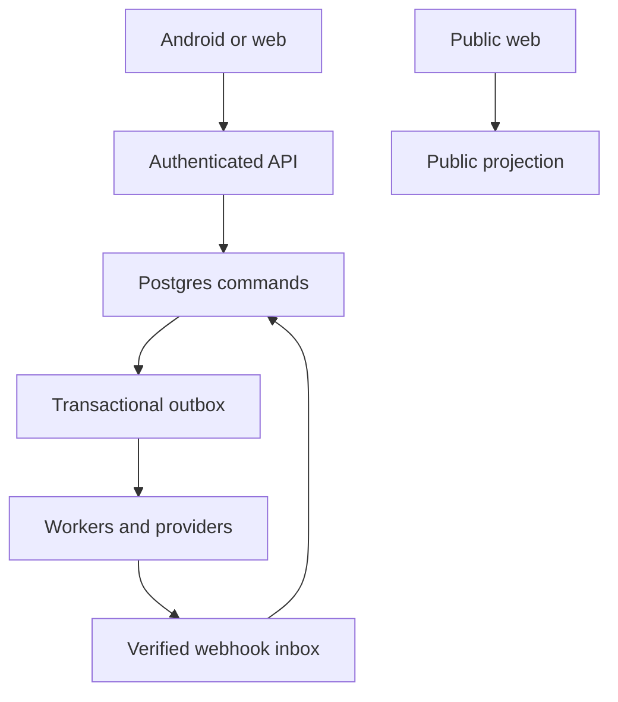

# Phase 2 — system architecture and trust boundaries

**Prepared:** 15 October 2026. **Status:** first architecture draft. This is a target for the fresh build, not a deployed system. Phase 1 owner-dependent decisions remain gated in `PHASE_1_AUDIT.md`. The removed `backend/001_monthly_contributions.sql` prototype and its original direct-RPC clients remain in Git history; they were never automatically approved migrations.

## Scope and design laws

- One masjid, Android APK and responsive web on a shared backend. Public site is anonymous; operators use named accounts and current active role. Client state never decides permission.
- INR is integer paise (`bigint` in Postgres; decimal string over JSON when a value might exceed JavaScript safe integer), server timestamps UTC, business date/period derived in `Asia/Kolkata`. Use `[start, end)` report ranges.
- Financial mutations are a single database transaction with actor, operation ID, source ID, before/after revision and audit. Network delivery is an outbox effect after commit.
- A posted correction is a reversal plus replacement or a void linked to the old effect; immutable source history remains reconstructable.
- Production operations cannot be inferred from a screen, JS bundle, fake fixtures, local export or a source backup. Evidence belongs to later phases.

## Components and owners

| Component | Owns | Allowed call/secret boundary |
|---|---|---|
| Android app (`apps/android`) | Role-aware forms, secure session, local allowed drafts, notification/device location prompts, update path | Publishable key/session only; no service key, Meta token, signing key, Drive credential or authority to post money offline. |
| Public web (`apps/web`) | Approved masjid content, published APK metadata, exact-code receipt entry, technical support | Anonymous fixed projections; never a broad table/Storage query. |
| Authenticated web | Named-user workspaces, server session, role-aware views, receipt/report downloads | SSR/server routes validate current user and object on every request; UI permission is advisory. |
| API facade (`backend/api`, planned) | Username login broker, typed command/query endpoints, request IDs, rate limits, current-client gate | Verify caller JWT/session and current DB account state. Server-only credentials held here, never exported to browser/APK. Privileged DB call includes verified actor context, not caller-supplied role. |
| Auth and identity (`backend/identity`) | Internal Auth user, unique username alias, one-use first-login credential state, active role, profile and audit | Username→internal Auth login identifier is private and server mediated. Auth token is not a fresh role proof; DB reads current role for every protected command. |
| Postgres (`backend/db`) | Constraints, transactional state, ledger, idempotency, consent, work, attendance, outbox/audit | Protected tables in unexposed schema where possible. Exposed read surfaces narrowly granted and RLS checked; privileged mutations use reviewed server-only functions in private schema. |
| Storage/renderers | Public approved media/APK; private QR, bill, memo, salary proof, report and receipt PDF | Bytes validated by type/size/content and metadata owner; private object access mediated by server, short-lived response. Object metadata and bytes backed up together. |
| Scheduler/outbox worker | First-Friday request, five-day reminder, meeting alerts, report render, retries and backups | Dedicated server credential/job scope; dequeue with lock and unique purpose key, recheck current consent/status before send. |
| Meta ingress | Signature verification, inbox event dedupe, STOP, transaction reference and delivery status | Only authenticated webhook ingress accepts provider events; text is untrusted, cannot verify money. |
| Backup/restore operator | Encrypted DB+object manifest, retention, secondary Drive copy, staging validation/cutover | L may request; server owns privileged credentials and audit. A failed preflight cannot replace live data. |

## Event and trust flow

The API never calls Meta or renders a PDF *inside* the money-posting transaction. Commit a durable outbox record with the transaction, then deliver/retry independently. A message failure changes delivery status, not posted money. Realtime/push is a hint to refetch current authorized state.

## Module/data ownership

| Module | Core aggregates | Write authority and source of truth | Read projection |
|---|---|---|---|
| Identity | app actor, username alias, role change, temporary credential, profile | SA for account lifecycle; self contact; L narrow contact edit | Own profile, member directory/performance field allowlist |
| Accounts and ledger | account, opening decision, balanced effects, transfer, reconciliation, correction | T posts; P verifies opening; DB constraints and idempotent transaction | P/VP/S/T and SA scoped support; others denied |
| Donor/receipt | monthly donor, consent version, suggestion version, QR activation, request, claim, contribution, receipt, referral event | Enrollment roles subject to Phase 1 approval; T verifies/rejects and posts; P/L QR | Roster without phone; pending claims T only; public exact receipt lookup after approval |
| Expenses/advances/payroll | submitted expense version, evidence, decision, payment, advance settlement, salary payment | Actor separation per Phase 1; T posts outflow | Leadership detail, SA support read; narrow member salary projection after approval |
| Work/performance | task, slot/waitlist, completion, decision, score source | P/VP/S creator; participant own; creator verifies; DB locks caps | Authorized task participants; all active member performance projection |
| Meetings/prayers | invite/RSVP, location evidence, roster finalization, absence, prayer mark revision | P/VP/S/L meeting; invited self; onsite organizer; P/VP/S/T prayer | Invitee and organizer scope; audit reviewers only for location proof |
| Content/release | announcement revision, audience, schedule, event media, APK manifest/policy | P/VP/S/L content; SA release policy after uploaded APK | Published public subset; active role workspace |
| Messaging/ops | inbox/outbox/delivery, job lease, backup manifest, restore run, report run | Dedicated server worker; L requests restore, not direct execution | Failure dashboard by authorized operator; private audit/report |

## Cross-aggregate invariants

1. Account closing balance = verified opening + posted inflows − posted outflows + transfer in − transfer out + linked correction effects. Claims, expected donor amounts, approvals, unpaid expenses and unverified cash are not effects.
2. One external transaction reference cannot post twice within its verified provider/account identity. One operation ID identifies one actor, command and canonical payload and returns the same outcome on replay; changed payload conflicts. Source ID uniquely links each posting.
3. A verified monthly claim posts actual paise, issues its own opaque receipt and referral event exactly once. The month is contributed after positive active postings; voiding the last active posting recomputes eligibility. No suggested-amount debt.
4. An expense decision applies to one submitted version and a different actor. T payment is capped at approved unpaid paise; revision of amount revokes prior approval. A transfer is balanced in the same transaction.
5. Task participation capacity and FIFO promotion serialize on the parent task. Meeting check-in is scheduled local date and current location, while post-day finalization only classifies unmarked invitees.
6. Public projections and private object access repeat authorization at request time. Role deactivation is effective at the next protected command despite token lifetime.

## Data placement and file lifecycle

- `public` is not a general write surface. Create private operational schemas for domain state and narrow exposed projections only when needed. Prefer server-only private functions for privileged writes. Any public RPC kept temporarily needs explicit `REVOKE EXECUTE FROM PUBLIC, anon`, explicit intended grant, pinned search path, actor/row guards and adversarial testing.
- New Supabase projects may not automatically expose newly created tables to the Data API; validate API exposure and grants deliberately. RLS and grants are separate checks. Never rely on a view owner's privileges to enforce caller RLS. See official [API security](https://supabase.com/docs/guides/api/securing-your-api) and [function security](https://supabase.com/docs/guides/database/functions).
- Storage classes: `public-assets` (approved gallery and release APK), `qr-private` (current image served in donor message by worker), `finance-private` (bills/proofs), `meeting-private` (memo), `generated-private` (receipts/reports). File bytes are staged, content/type/size checked, then metadata promoted; orphan staging is reclaimed. No private permanent public URL.
- Retention of personal content remains an owner/privacy gate. Financial/actor link history is preserved pending reviewed deletion policy; backup retention is 30 daily plus 12 monthly source-and-object archives, separate from live records.

## Environment and operational boundaries

Local/development, staging/preview and production use distinct Auth users, DB, Storage, Meta config, site base URL, secrets and scheduled jobs. Production sending disabled until QR/account, Business number, template and privacy review are verified. Staging uses test data; destructive restore tested on isolated staging. A signed APK's version and backend minimum version are released together only after the public download URL is live.

**Architecture review still needed:** owner-dependent donor-edit grant, referral scoring, laptop expense routing, salary/public receipt publication and privacy schedule. They have no production-enabling default. Phase 2 may define storage and disabled interfaces without granting these actions.
